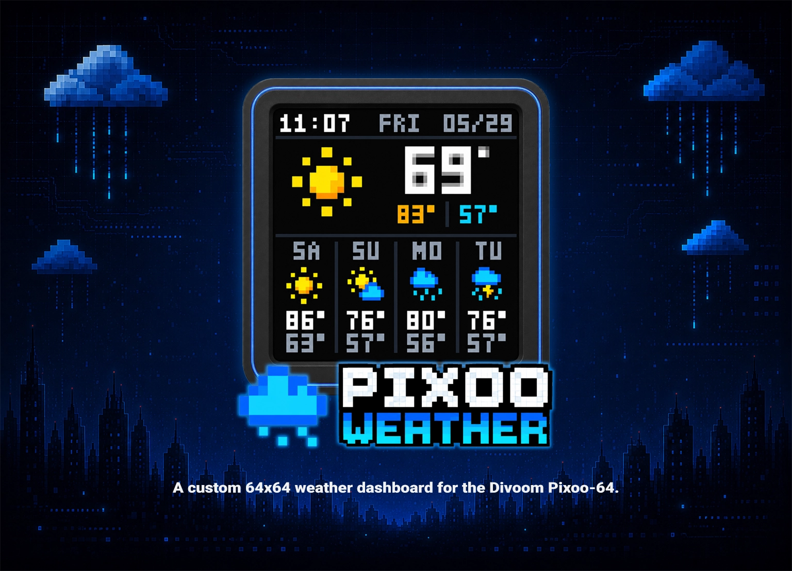
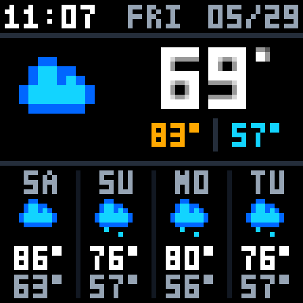

# Pixoo Weather

A custom 64x64 weather dashboard for the Divoom Pixoo-64.

The app runs on a Raspberry Pi, fetches weather from Open-Meteo, renders a
pixel-precise dashboard with Python/Pillow, and sends the output to a Pixoo
through a local `pixoo-rest` bridge.

## Screenshot

## Features

- 64x64 Pixoo dashboard with clock, date, current weather, and 4-day forecast.
- Open-Meteo WMO weather-code mapping with intentional pixel-art icons.
- Night-aware current-condition icons for clear/mainly-clear/partly-cloudy.
- Distinct unknown-weather icon for unexpected weather codes.
- Static image upload mode by default to reduce Pixoo refresh flicker.
- Swappable icon-set structure with a preserved `legacy_pixel` fallback.
- Local preview tooling and an editable pixel-grid dashboard/icon editor.
- Optional systemd services for Raspberry Pi auto-start and restart behavior.

## Getting started

You need a Raspberry Pi, a Divoom Pixoo-64, Python, and a separately installed
`pixoo-rest` bridge. This project supplies the dashboard application.

Follow the [setup and run guide](docs/workflow.md#initial-setup) to create the
Python environment, configure your device/location, and start the bridge and
dashboard. The same guide covers optional systemd auto-start, deployment,
updates, and troubleshooting commands.

## Preview and editor

Inspect the dashboard and edit pixels locally with the [dashboard editor](docs/dashboard-editor.md).
See [local testing](docs/workflow.md#local-testing) for weather-code previews
and baseline icon sheets.

## Project Structure

- `app.py` - weather fetch loop and Pixoo upload behavior.
- `renderer.py` - 64x64 dashboard layout and rendering.
- `functions.py` - active function-drawn weather icon art.
- `icon_sets/` - icon-set routing and legacy/current icon themes.
- `make_dashboard_mockup.py` - generates the editable dashboard/icon grid.
- `make_weather_code_legend.py` - generates weather-code icon previews.
- `scripts/` - deploy/start/systemd helper scripts.
- `systemd/` - Raspberry Pi service templates.
- `docs/` - installation, runtime, and editor documentation.

## Documentation

- [Setup and workflow](docs/workflow.md) - setup, run, test, deploy, update.
- [Dashboard editor](docs/dashboard-editor.md) - preview/editor usage.
- [Changelog](CHANGELOG.md) - completed changes by version.
- [Attribution](ATTRIBUTION.md) - upstream provenance and source notes.

## Attribution and licensing

This project is derived from `jankornfeld/pixoo-weather`. At the time checked,
that upstream repository did not visibly include a license file. See
[ATTRIBUTION.md](ATTRIBUTION.md) before redistributing, relicensing, or treating
this as an unrestricted open-source project.
